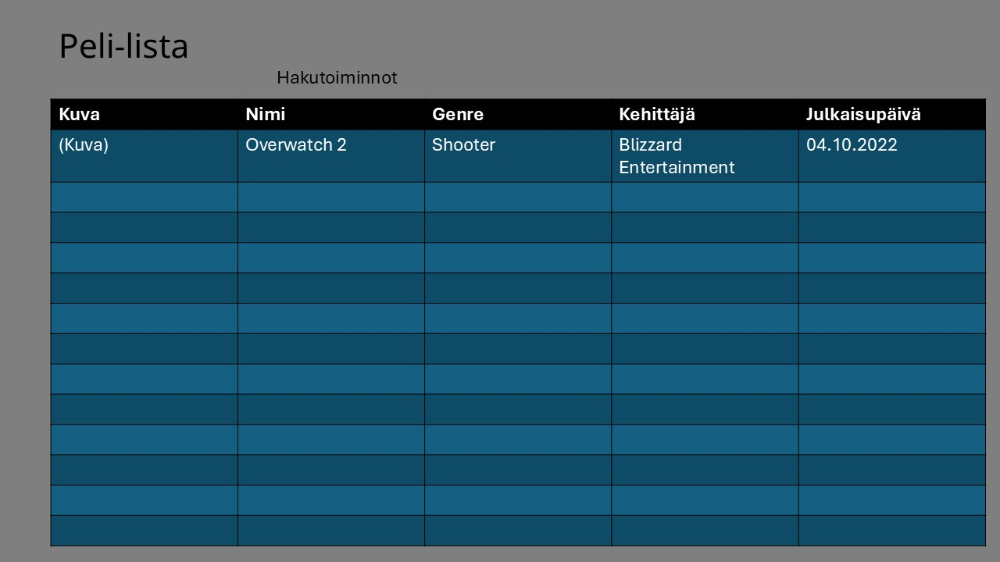
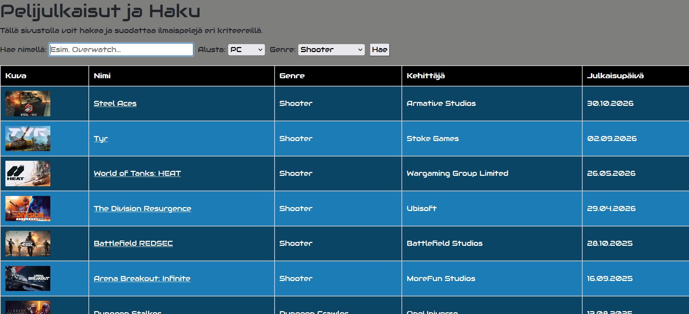

# Projektin nimi

**Tekijä(t):** Juha Korhonen / Jon Mattila

## Projektisuunnitelma

### Projektin idea

Sovellus näyttää 50 viimeisintä pelijulkaisua avatessa ja käyttäjä voi hakea pelejä käyttämällä hakutoimintoja.

### Suunnitellut toiminnot

Listaa vähintään kolme sovellukseesi suunniteltua toimintoa:

- Näyttää sivun auetessa 50 viimeisintä pelijulkaisua.
- Käyttäjä voi hakea pelejä hakutoiminnolla.
- Käyttäjä voi siirtyä pelin sivulle linkistä.

### Rautalankamalli / luonnos

Lisää tähän kuva käsin piirtämästäsi tai digitaalisesti tehdystä sovelluksen luonnoksesta. Luonnoksessa tulee näkyä sovelluksen pääasiallinen näkymä ja tärkeimmät elementit.

Esimerkki kuvan lisäämisestä:

## Verkkolinkit

- **Julkaistu sovellus:** [Lisää tähän GitHub Pages -osoite](https://jon-code-87.github.io/Web_development_-Projekti_3/index.html)
- **GitHub-repositorio:** [Lisää tähän repositorion osoite](https://github.com/Jon-code-87/Web_development_-Projekti_3)
- **Projektin videoesittely:** [Lisää tähän videon osoite](https://example.com/)

## Tietoja sovelluksesta

**Pelijulkaisut** on verkkosovellus, joka näyttää pelit freetogame-sivustolta hakemalla rajapintoja.

## Teknologiat

Kuvaile, mitä teknologioita käytit ja mikä niiden rooli oli projektissasi.

- HTML – sivun rakenne
- CSS – ulkoasu ja asettelu
 - Bootstrap
- JavaScript – toiminnallisuus, DOM-skriptaus ja lomakkeiden validointi
 - jQuery - AJAX ja JSON

## Sovelluksen käyttö

Kirjoita lyhyet käyttöohjeet sovellukselle.

1. Avaa julkaistu sovellus yllä olevasta linkistä.
2. Täytä lomakkeen kentät ja valitse alasvetovalikoista.
3. Paina Hae-nappia.

## Sovelluksen käynnistäminen paikallisesti

1. Kloonaa tai lataa tämä repositorio omalle koneellesi.
2. Avaa projektikansio.
3. Avaa `index.html` selaimessa.

## Kuvakaappaukset

Lisää tähän vähintään yksi kuvakaappaus toimivasta sovelluksestasi.

Esimerkki kuvan lisäämisestä:

## Tunnetut virheet / puutteet

**Ei tunnettuja virheitä.**

## Työn jakautuminen

Jatkettu Projekti 2:sta. Repositorio sijaitsee Jon Mattilan githubissa. Ohjelman koodaus toteutettiin pääasiassa Juhan tietokoneella.

Molemmat osapuolet osallistuivat aktiivisesti ohjelman kehittämiseen, ja työtehtävät jakautuivat tasaisesti tekijöiden kesken. Yhteistyö sujui hyvin ja ongelmitta koko projektin ajan. Ohjelmaa kehitettiin molempien vapaa-ajalla.

## Oma arvio ja oppimisen reflektointi

Pohdi työtäsi ja oppimisprosessiasi.

- Missä onnistuin? Löydettiin ulkoiset kirjastot.
- Mikä oli haastavaa? jQueryn ymmärtäminen ja mikä siinä mukamas helpottaa javascriptin käyttämistä.
- Mitä parantaisin, jos aikaa olisi enemmän? En mitään. It's perfect!
- Mitä opin HTML:stä, CSS:stä, JavaScriptistä ja DOM-skriptauksesta? jQueryn käyttö tuntui turhalta.
- Mikä jäi epäselväksi tai mistä haluaisin oppia lisää? Kaikesta.
- Oma arvio projektista: **10/10 pistettä**

## Lähteet ja kiitokset

- Lopullinen työ on luotu opiskelijoiden ideasta.

- Geminiä on ohjattu opiskelijoiden haluamaan suuntaan.

- Käytetty hyväksi aikaisempia workshoppeja ja opiskelumateriaalia.

- Font-familyt selvitettiin Google Font Familysta.

- Käytetty Geminiä kommenttien jäsentelyyn.

- API: www.freetogame.com/api-doc

- jQuery: https://code.jquery.com/jquery-4.1.0.min.js

- Bootstrap: https://cdn.jsdelivr.net/npm/bootstrap@5.1.1/dist/css/bootstrap.min.css

  ## Lisenssi

Tämä projekti on lisensoitu MIT-lisenssillä.

Lisätietoa lisenssin lisäämisestä GitHub-projektiin:
https://docs.github.com/en/communities/setting-up-your-project-for-healthy-contributions/adding-a-license-to-a-repository